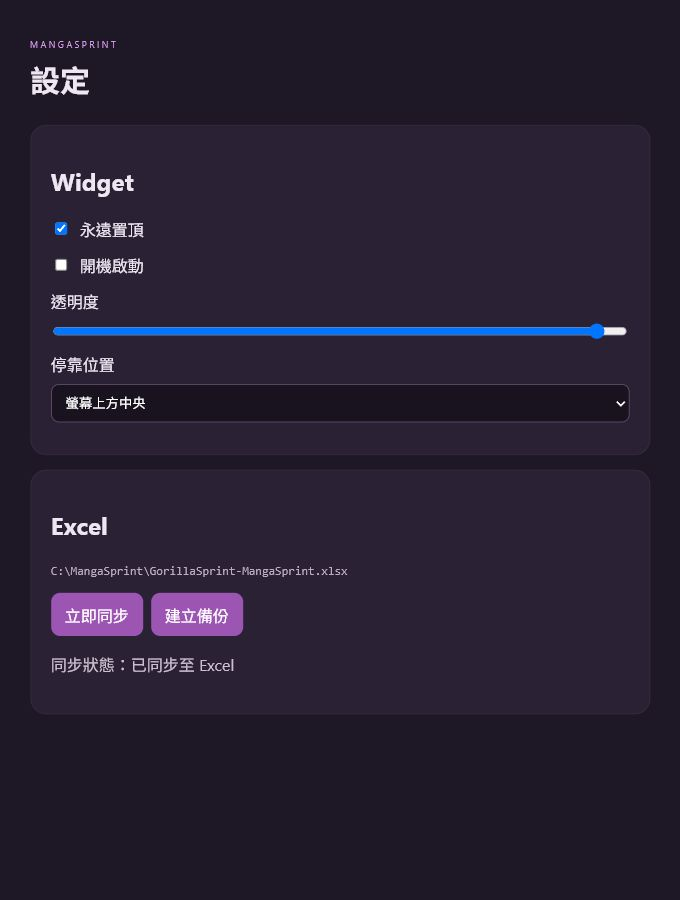

# MangaSprint

MangaSprint 是一個本機單人使用的 Windows 漫畫製作進度 Widget。它會依照每話起訖日期計算今天的理想進度，讓你用 `＋1 頁`、`−1 頁` 快速更新實際完成頁數，並將紀錄安全同步到 Excel。

## v0.2.0：同時管理多部漫畫

- 上方每個分頁代表一部漫畫，各自保留進度、排程與 Excel 路徑。
- 按 `＋` 選擇另一份 Excel，即可新增漫畫分頁；在既有漫畫分頁按「重匯」則只替換該漫畫。
- 「總結」分頁會列出每部漫畫今天的狀態，並加總今天仍缺的頁數。
- 加總只計算落後量：某部漫畫超前不會抵銷另一部漫畫的待完成頁數。
- 舊版的單一漫畫資料會在第一次開啟時自動移入第一個分頁，不必重新匯入。
- 「同步全部」會把每部漫畫分別寫回各自的 MangaSprint Excel；任一檔案被鎖定時，該部作品的待同步進度仍保存在 App。
- 匯入有 `DailyPlan` 的 MangaSprint Excel 時，會保留逐日理想頁數及休息日，不再重新平均分配。調整總頁數只縮放該話的排程，其他話保持原樣。


> 文件截圖使用示範資料，不包含使用者私人檔案或實際路徑。

## 線上互動 Demo

不想先安裝也可以直接開啟
[MangaSprint Web Demo](https://princeborn1999.github.io/manga-sprint/)。

Demo 使用固定的匿名示範資料，可以體驗展開／縮小、增減完成頁數及調整總頁數。它不會讀取、上傳或保存你的 Excel；Excel 同步、系統匣、開機啟動與桌面置頂是 Windows 安裝版限定功能。

## 下載

一般使用者不需要下載原始碼，也不需要安裝 Node.js。請到
[GitHub Releases](https://github.com/princeborn1999/manga-sprint/releases/latest)
下載最新的 Windows x64 安裝程式：

```text
MangaSprint-0.1.1-x64.exe
```

`v0.1.1` 修正重新匯入 MangaSprint Excel 時，16 頁話數可能被舊版誤判為完成 16% 的問題，並會保留每話既有總頁數與起訖日期。

Release 頁面也會附上可直接匯入的範例 Excel。請勿下載 GitHub 首頁自動產生的
`Source code (zip)` 當成安裝程式。

## 5 分鐘快速開始

1. 從 [Releases](https://github.com/princeborn1999/manga-sprint/releases/latest) 下載並執行安裝程式。
2. Windows SmartScreen 若出現警告，確認發行者與下載來源後，按「其他資訊」→「仍要執行」。
3. 開啟 MangaSprint，將自己的 `.xlsx` 拖進 Widget；想先試用可匯入 Release 內的範例檔。
4. 在匯入畫面確認話數範圍與預設每話 18 頁，按「匯入並建立」。
5. 用 `＋1 頁`、`−1 頁` 更新進度。畫面顯示「已同步」代表 Excel 也已更新。

## 主要功能

- 固定在螢幕頂端的無邊框 Widget。
- 展開與縮小模式，縮小後仍可左右拖曳位置。
- 依工作日期計算目前理想進度及相差頁數。
- 快速增加或減少實際完成頁數。
- 畫到一半可直接增加或刪除該話總頁數。
- 拖放或選擇 `.xlsx` 匯入。
- App 狀態即時保存在本機，Excel 被鎖定時不會遺失進度。
- 自動同步及手動同步 Excel。
- Excel 寫入前建立備份、使用臨時檔驗證，再替換正式檔案。
- 系統匣、永遠置頂、透明度及開機啟動設定。

## 系統需求

- Windows 10 或 Windows 11 x64。
- 安裝版已包含 Electron，不需要另外安裝 Node.js、Rust、Tauri 或 WebView2。
- App 本身不需要 Microsoft Excel；只有在你想人工查看或編輯 `.xlsx` 時才需要 Excel 或其他相容軟體。

## 安裝

從 [GitHub Releases](https://github.com/princeborn1999/manga-sprint/releases/latest)
下載並執行 Windows x64 安裝程式：

```text
MangaSprint-0.1.1-x64.exe
```

目前安裝程式沒有商業程式碼簽章，Windows SmartScreen 可能顯示警告。請確認檔案來源可信，再選擇「其他資訊」→「仍要執行」。

安裝完成後可以從桌面捷徑或開始功能表開啟 MangaSprint。

若想在不影響正式資料的情況下先試用，請先匯入
[`examples/mangasprint-sample.xlsx`](examples/mangasprint-sample.xlsx)。

## 第一次使用：匯入 Excel

1. 開啟 MangaSprint。
2. 將 `.xlsx` 拖進 Widget，或按「匯入 Excel」。
3. 確認辨識出的話數範圍及目前進度。
4. 預設每話總頁數為 18；匯入後仍可逐話加頁或刪頁。
5. 按「匯入並建立」。


舊式橫向 Excel 不會被修改。程式會讀取資料後，在相同資料夾建立新的 MangaSprint Excel：

```text
原檔名-MangaSprint.xlsx
```

支援的橫向格式是每話三欄：

```text
第幾話理想完成% | 實際完成% | 日期
```

程式也能重新匯入自己產生的 MangaSprint Excel，並保留：

- 每話總頁數。
- 實際完成頁數。
- 話數起訖日期。
- 完成狀態。

## Widget 操作

### 更新實際完成頁數

- `＋1 頁`：實際完成頁數增加一頁。
- `−1 頁`：實際完成頁數減少一頁。
- 百分比、相差頁數及當日紀錄會立即重新計算。

### 中途增加或刪除總頁數

話數總頁數旁有小型 `−`、`＋` 按鈕：

- 增加總頁數時，已完成頁數保持不變。
- 刪除總頁數時，只要新總頁數仍高於已完成頁數，完成頁數保持不變。
- 如果新總頁數低於已完成頁數，App 會先要求確認。
- 確認後，已完成頁數會一起縮減到新的總頁數，代表實際刪除了已完成頁面。
- 理想排程會依新總頁數重新分配。

例如：

```text
6 / 18 → 增加總頁數 → 6 / 20
16 / 18 → 總頁數改為 14 → 確認刪頁 → 14 / 14
```

### 理想進度與相差頁數

- 「理想進度」是依目前日期及該話工作期間計算出的目標百分比。
- `−6 頁` 代表目前落後理想進度 6 頁。
- `＋2 頁` 代表目前領先理想進度 2 頁。

## 縮小、展開及移動

按 Widget 最上方的 `⌃` 可以縮小。


- 縮小後只顯示目前話數及頁數。
- 點擊縮小列即可展開。
- 按住縮小列文字附近左右拖曳，可以沿著螢幕頂端移動。
- 垂直位置會固定在螢幕最上方，不會被往下拖動。
- 縮小區域以外不會擋住後方視窗點擊。

## 「同步」是什麼？

同步是把 App 本機 Store 中的最新狀態寫入 MangaSprint Excel。

每次修改進度或總頁數時：

1. App 先立即保存到本機 Store。
2. 將狀態標記為「待寫入 Excel」。
3. 在背景自動嘗試同步。
4. 成功後顯示「已同步」。

平常不需要每次手動按「同步」。手動同步主要用於：

- Excel 原本開著，導致檔案被鎖定。
- 上一次背景寫入失敗。
- 想在關閉 App 或複製檔案前確認 Excel 已是最新狀態。

同步寫入流程：

1. 驗證話數、頁數及日期。
2. 本機 Store 保留最新狀態。
3. 備份現有 MangaSprint Excel。
4. 在相同資料夾寫入臨時 `.xlsx`。
5. 重新讀取臨時檔確認有效。
6. 成功後才替換正式 Excel。
7. 失敗時保留「待寫入」狀態，App 進度不會消失。

## 本機快取與重新開啟

MangaSprint 使用 `electron-store` 保存即時狀態。

- 每次操作會先保存到 Store。
- 關閉或重新啟動後，會從 Store 恢復上次狀態。
- 啟動時不會每次重新解析 Excel。
- Excel 是正式的人類可讀紀錄及額外備份。
- 如果上次尚未寫入 Excel，重新開啟後仍會顯示「待寫入 Excel」。

視窗的關閉按鈕預設只會隱藏到系統匣。要完全關閉，請使用系統匣選單的「結束程式」。

## 設定



設定頁提供：

- 永遠置頂。
- 開機啟動。
- Widget 透明度。
- 停靠位置。
- 立即同步。
- 手動建立 Excel 備份。
- 目前 Excel 路徑及同步狀態。

## 換到另一台電腦

### 還沒開始使用 MangaSprint

1. 複製安裝檔及原始排程 Excel 到新電腦。
2. 安裝 MangaSprint。
3. 匯入原始 Excel。
4. 確認預設總頁數後開始使用。

### 已經使用一段時間，要連進度一起搬移

1. 在舊電腦關閉 Excel。
2. 確認 MangaSprint 顯示「已同步」；若不是，按一次「同步」。
3. 完全結束 MangaSprint。
4. 複製最新的 `*-MangaSprint.xlsx` 到新電腦。
5. 在新電腦安裝 MangaSprint。
6. 匯入這份 MangaSprint Excel。

每話總頁數與實際完成頁數會保留。視窗位置、透明度及開機啟動屬於每台電腦的本機設定，需要在新電腦重新設定。

不要讓兩台電腦同時修改各自的 Excel；目前沒有雲端合併功能。

## 常見問題與排除方式

### 拖入 Excel 沒有反應

- 確認檔案副檔名是 `.xlsx`，不是舊式 `.xls`、CSV 或 Google Sheets 捷徑。
- 改用 Widget 內的「匯入 Excel」按鈕選取檔案。
- 關閉正在顯示匯入畫面的其他 MangaSprint 視窗；App 只允許一個執行個體。
- 仍失敗時，先用本專案的範例檔測試，以判斷是檔案格式或 App 問題。

### 一直顯示「待同步」

1. 關閉 Microsoft Excel 或其他正在開啟 MangaSprint 工作簿的程式。
2. 從系統匣開啟 MangaSprint，按「立即同步 Excel」。
3. 確認狀態變成「已同步」後再複製或搬移工作簿。

即使同步失敗，最新操作仍保存在 App 的本機 Store；不要急著重新匯入舊 Excel，以免把目前畫面切換成另一份專案。

### 關閉視窗後 App 還在

這是預期行為。關閉按鈕會將 Widget 隱藏到 Windows 系統匣，避免誤關。要完全結束，請在系統匣圖示上開啟選單並選「結束程式」。

### 找不到 Widget

- 從系統匣選單選「顯示 Widget」。
- 再次從桌面或開始功能表開啟 MangaSprint，既有視窗會被顯示並聚焦，不會產生第二個 Widget。

### 如何備份

- 一般進度同步時，程式會在替換 Excel 前建立備份。
- 需要立即備份時，可在設定頁按「手動建立 Excel 備份」。
- 跨電腦搬移前，最重要的是複製狀態已為「已同步」的 `*-MangaSprint.xlsx`。

## 解除安裝與資料保留

- 從 Windows「設定」→「應用程式」解除安裝 MangaSprint。
- 解除安裝程式預設不刪除 App 的本機 Store，重新安裝後仍有機會恢復原狀態。
- 你選取的原始 Excel、MangaSprint Excel 與備份不會隨 App 解除安裝而刪除。
- 若要永久清除資料，請先自行備份 Excel，再移除 MangaSprint 的使用者資料；操作前請確認路徑，避免刪到其他 Electron App 的資料。

## 隱私與資料範圍

- MangaSprint 是本機 App，不需要登入，也不會把漫畫進度上傳到 GitHub。
- 公開的是程式原始碼、文件、示範截圖、範例 Excel 與安裝程式。
- 你的個人 Excel 只會由本機 App 讀寫；除非你自己上傳或分享，否則不會出現在 repository 或 Release。
- 錯誤紀錄不應包含工作簿內容；回報問題前仍建議先檢查截圖與附件是否含私人資訊。

## 開發

### 技術架構

- Electron
- React
- TypeScript
- Vite / electron-vite
- Zustand
- SheetJS (`xlsx`)
- electron-store
- Vitest
- ESLint / Prettier
- NSIS Windows x64 installer

### 安裝依賴並啟動

```powershell
npm install
npm run dev
```

### 驗證

```powershell
npm run typecheck
npm run lint
npm run test
npm run build
```

### 建立 Windows 安裝檔

```powershell
npm run dist:win
```

輸出位置：

```text
release/MangaSprint-0.1.1-x64.exe
```

## 專案結構

```text
src/
  main/
    excel/       Excel 匯入、備份、驗證及原子替換
    ipc/         型別化 IPC handlers
    services/    進度及總頁數更新
    storage/     electron-store
    tray/        系統匣
    windows/     Widget 視窗及拖曳
  preload/       安全 contextBridge API
  renderer/
    components/  Widget
    dialogs/     匯入確認
    pages/       設定頁
    stores/      Zustand
    styles/
  shared/
    calculations/
    constants/
    date/
    types/
    validation/
tests/
docs/images/
examples/
```

## 安全設計

- `contextIsolation: true`
- `nodeIntegration: false`
- Renderer sandbox
- Renderer 不直接讀寫任意本機檔案
- Excel 路徑由原生選檔器或拖放取得
- Main process 驗證檔案、副檔名、話數、頁數及日期
- 不執行任意 shell 指令
- 不載入遠端網頁
- 不使用雲端資料庫、登入或付費 API

## 已知限制

- 僅支援 Windows x64。
- 安裝程式目前沒有程式碼簽章，可能觸發 SmartScreen。
- 沒有雲端同步或多電腦衝突合併。
- 匯入 MangaSprint Excel 時會恢復話數、總頁數、實際進度及日期，但不會搬移視窗位置等本機設定。
- Excel 的複雜舊格式不會原樣保留；舊檔只讀，程式會建立自己的新版工作簿。
- 請只匯入來源可信的 `.xlsx`。
